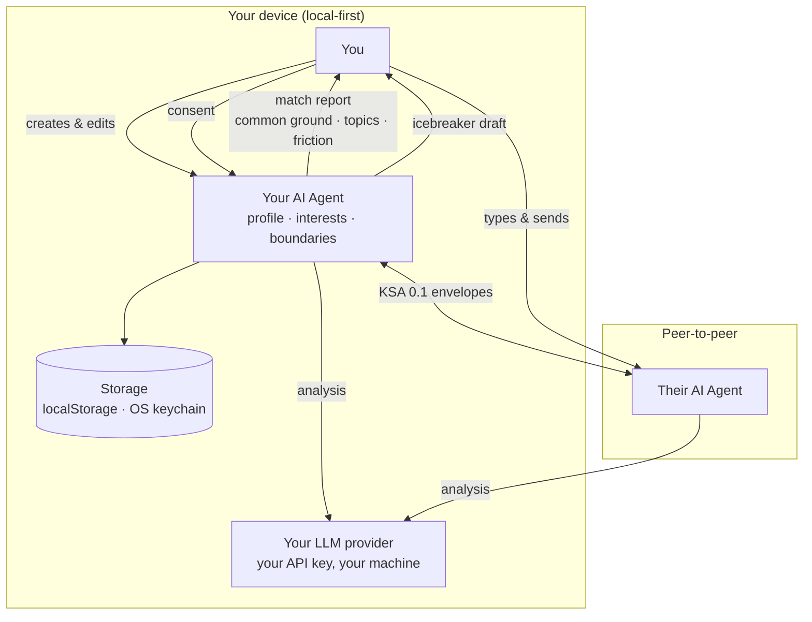

# Kindora

### Your AI finds the connection. You make the friendship.

An open-source, local-first AI social agent client exploring a new way for people
to connect through personal AI agents.

**Your AI discovers common ground. You decide who to connect with.**

[](https://github.com/free-revalution/Kindora/actions/workflows/ci.yml)
[](LICENSE)
[](https://github.com/free-revalution/Kindora/stargazers)
[](https://github.com/free-revalution/Kindora/issues)
[](https://github.com/free-revalution/Kindora/discussions)


---

## What is Kindora?

Kindora is an open-source experiment exploring AI-assisted social discovery.

Instead of relying entirely on a traditional recommendation algorithm, Kindora
gives each person a personal AI agent. That agent understands the user's
interests, social intent and conversation style, and helps discover meaningful
connections with other people's agents.

The user stays in control of their profile, their privacy boundaries, and every
connection decision. Kindora never sends a message on your behalf.

**Kindora is not a dating app, and not a feed.** There is no ranking algorithm
deciding what you should see. Two agents meet, find common ground, and report
back — a human decides what happens next.

---

## How it works



Legend — **solid lines are implemented and covered by automated tests**; the
dashed edge below is **planned, not implemented**:

- ✅ Implemented: profile storage, KSA 0.1 envelopes (validated, replay-guarded,
  rate-limited), LAN transport (real UDP + TCP), agent-to-agent matching,
  consent, icebreaker, chat.
- ⛔ Not implemented: cross-network (WebRTC) pairing — `WebRtcTransport` is a
  stub and `connect()` throws. **Same-LAN only.**

Full capability-by-capability status, with the evidence for each claim:
[docs/DEVELOPMENT_STATUS.md](docs/DEVELOPMENT_STATUS.md).

---

## Status: read this before you assume anything works

**V0.1 — Experimental. Source only: no releases, no installers.**

> The desktop app builds and launches, but **no complete two-machine session has
> been driven through the GUI by hand yet**, and **no automated test has ever
> called a live LLM provider** — every LLM test mocks `fetch`. Real API
> schemas, auth headers and error shapes remain unverified.
>
> What _is_ green under automated tests: the whole TypeScript workspace
> (**1035 cases across seven suites**) and the Rust transport layer (**48 cases
> across four suites**), plus the whole toolchain gate — the type check, ESLint,
> the package build, `cargo fmt --check` and `cargo clippy -D warnings` all
> pass. The LAN integration suite binds **real UDP and TCP sockets**; it does
> not exercise the React UI against a real Tauri window.
>
> **One gate is still red:** `pnpm format:check` reports **111 files** that have
> never been Prettier-formatted — the baseline commit's own files included, so
> this is pre-existing and not a regression. The fix is `pnpm format`. Until
> then CI's format step fails **on purpose**: a check that always passes is not
> a check. See [docs/REMEDIATION_PROGRESS.md](docs/REMEDIATION_PROGRESS.md).
>
> **No remediation phase is marked `VERIFIED` yet.** The remediation's phase
> vocabulary is stricter than "the tests are green" — a phase stays
> `IMPLEMENTED` until every one of its acceptance rows is green, and several
> rows are still open (real SQLite in CI, the manual two-device walkthrough,
> the live-provider tests).

Please read the [Features](#features) section before opening an issue that
assumes a feature works.

---

## Features

### ✅ Implemented and covered by automated tests

| Feature                                                                                                                                                                                                                                                           | Where                                                                                                                                 |
| ----------------------------------------------------------------------------------------------------------------------------------------------------------------------------------------------------------------------------------------------------------------- | ------------------------------------------------------------------------------------------------------------------------------------- |
| Personal AI social agent — create, edit, persist                                                                                                                                                                                                                  | `packages/agent`, `packages/storage`                                                                                                  |
| Bring-your-own LLM — OpenAI-compatible, Anthropic, Ollama, MiniMax                                                                                                                                                                                                | `packages/llm`, `apps/desktop/src/lib/llm-service.ts`                                                                                 |
| API keys in the OS-native secret store (macOS Keychain / Windows Credential Manager / Linux Secret Service)                                                                                                                                                       | `apps/desktop/src-tauri/src/secrets.rs` (`keyring`)                                                                                   |
| KSA 0.1 wire protocol — schema validation, replay guard, rate limiter, sensitive-field guard                                                                                                                                                                      | `packages/protocol`                                                                                                                   |
| **Phase A** — Envelope signatures — ES256 over a canonical (RFC 8785) payload digest, bound to one recipient                                                                                                                                                      | `packages/protocol` (`signature.ts`, `canonical-json.ts`)                                                                             |
| **Phase A** — End-to-end encrypted LAN sessions — ECDH P-256 + HKDF-SHA256 + AES-256-GCM, header + signature as AAD                                                                                                                                               | `packages/transport` (`session-crypto.ts`)                                                                                            |
| **Phase A** — Pairing by **identity fingerprint** (the host's public key) instead of a random code                                                                                                                                                                | `packages/transport` (`pairing-fingerprint.ts`)                                                                                       |
| **Phase A** — The agent's identity key in the **OS keychain** (desktop app)                                                                                                                                                                                       | `apps/desktop/src-tauri/src/secrets.rs` (`agent_key_*` commands)                                                                      |
| LAN transport — UDP broadcast discovery on port **52419**, then a TCP channel                                                                                                                                                                                     | `packages/transport`, `apps/desktop/src-tauri/src/lan.rs`                                                                             |
| Loopback transport for in-process development and tests                                                                                                                                                                                                           | `packages/transport`                                                                                                                  |
| Agent-to-agent matching — 5-field report (compatibility signal, common ground, recommended topics, potential friction, explanation)                                                                                                                               | `packages/agent`, `packages/matching`                                                                                                 |
| Human consent flow — accept / reject / disconnect / block, with a persisted block list                                                                                                                                                                            | `packages/matching`, `packages/storage`                                                                                               |
| Icebreaker generation — propose, use, edit, regenerate, skip                                                                                                                                                                                                      | `packages/agent`, `packages/matching`                                                                                                 |
| Human-to-human chat, plus an "Ask My Agent" panel that only fills your draft                                                                                                                                                                                      | `packages/matching`, `apps/desktop/src/views/ChatView.tsx`                                                                            |
| Prompt-injection sanitiser — every piece of remote content is delimited, escaped and source-labelled; the regexes are the **second** layer, not the only one                                                                                                      | `packages/protocol/src/prompt-injection-guard.ts`                                                                                     |
| English + 简体中文 UI, switchable in Settings                                                                                                                                                                                                                     | `apps/desktop/src/i18n`                                                                                                               |
| Human in the loop throughout — **the AI never auto-sends**                                                                                                                                                                                                        | `packages/matching`                                                                                                                   |
| **Phase B** — Per-field authorisation — 10 switches, minimum-necessary defaults (interests on, bio / current activity / avatar off)                                                                                                                               | `packages/protocol/src/profile-privacy-filter.ts`, `apps/desktop/src/views/{CreateAgentForm,Settings}.tsx`                            |
| **Phase B** — Two-phase disclosure — minimal public card → human consent → authorised profile                                                                                                                                                                     | `packages/matching/src/orchestrator.ts` (`identify()` → `exchangeAndMatch()`)                                                         |
| **Phase B** — Block list — enforced before anything goes out, with a management screen                                                                                                                                                                            | `packages/storage/src/blocked-agents-store.ts`, `apps/desktop/src/views/BlockedAgentsView.tsx`                                        |
| **Phase D** — A real local business database (SQLite) — six business tables plus a migration ledger, an idempotent migrator and a version row; **chat history is written down before a message goes out** (`PENDING` → `SENT` / `FAILED`)                         | `packages/storage/src/{sql-migrations,sql-migrator,sqlite-database,chat-repository}.ts`, `apps/desktop/src/lib/tauri-sql-executor.ts` |
| **Phase E** — One error model and one transport layer behind every LLM provider: a unified timeout, cancellation, a bounded retry that honours `Retry-After`, and three layers of key redaction                                                                   | `packages/llm/src/{errors,http}.ts`, `apps/desktop/src/lib/llm-service.ts`                                                            |
| **Phase F** — Prompt-injection defence **by structure**: each piece of remote content goes into an explicit, escaped, source-labelled untrusted block, oversized content is dropped and reported, and the sensitive-field guard **refuses what it cannot verify** | `packages/protocol/src/{prompt-injection-guard,sensitive-field-guard}.ts`, `packages/agent/src/context-builder.ts`                    |

> The rows marked **Phase A** were added by the security remediation. Their test
> cases were **run and came back green** in the 2026-11-04/05 remediation
> batches, but **no two-machine session has been driven by hand**. See
> [docs/REMEDIATION_PROGRESS.md](docs/REMEDIATION_PROGRESS.md) for the exact
> state of each item.
>
> The rows marked **Phase B** were added by the privacy remediation. The
> protocol, agent, matching **and desktop** suites all came back green —
> including the 13 desktop cases for the privacy-boundary UI.
>
> The rows marked **Phase D** / **Phase E** / **Phase F** were added by the
> database, provider-reliability and prompt-injection remediations. Their test
> suites are green, but the **packaged app has never been driven by hand**, so
> the restart path, the live provider calls and the adversarial samples are all
> still unproven in the real thing.

### 🧪 Implemented, but not yet validated end-to-end

- **The desktop app in a real window.** It builds and runs. A full two-machine
  session has not been completed by hand.
- **Every LLM-dependent feature.** All tests mock `fetch`. No test has called a
  live provider.
- **LAN pairing through the GUI.** Verified at the Rust socket layer and via a
  JS IPC shim — not through React against a real Tauri window.
- **SQLite persistence.** The desktop app opens a real local database through
  `tauri-plugin-sql` (`apps/desktop/src/lib/tauri-sql-executor.ts`), with an
  idempotent migration and a version ledger. The storage suite is green
  (168/168), but **the packaged app has not been driven by hand** — CI has no
  SQLite and no Tauri runtime, so "restart the app and the data is still there"
  is still unverified.
- **Chat history persistence.** Every message is written down before it goes
  out (`PENDING` → `SENT` / `FAILED`; an incoming one is `DELIVERED`), and the
  history is readable from a screen (`ChatHistoryView`). Same caveat as above:
  **never driven by hand in the packaged app.**
- **The privacy and block-list screens.** Per-field authorisation switches with
  the minimum-necessary defaults (interests on, bio / current activity / avatar
  off) and a block-list screen exist and are covered by tests — the desktop
  suite is green (151/151) — but **the packaged app has not been driven by
  hand**.

### ❌ Not implemented

- **WebRTC / cross-network pairing** — `WebRtcTransport` is a stub; every entry point
  throws a typed `WebRtcNotImplementedError` (code `WEBRTC_NOT_IMPLEMENTED`) and no
  code path lets it look connected. That is deliberate, and it is **pinned by
  tests** — the stub's behaviour, the signalling contract and the capability
  cross-check between two peers are all covered, so a "connected" state cannot
  appear by accident. **Same-LAN only.**
- **A Rust-side signer** — the agent's private key lives in the **OS keychain**,
  but it is read back into the webview to sign there (imported as a
  non-extractable WebCrypto key, so it cannot be exported once it is inside).
  A Rust `agent_sign` command is not implemented. In browser dev mode there is
  no keychain, so the key stays in `localStorage`.
- **QR-code pairing** — the payload helpers exist in
  `packages/transport/src/qr-payload.ts`; there is no UI.
- **Releases / installers** — none. Build from source.

---

## Technology stack

| Layer            | Choice                                                                                                                                                                                                                              |
| ---------------- | ----------------------------------------------------------------------------------------------------------------------------------------------------------------------------------------------------------------------------------- |
| Desktop shell    | [Tauri 2](https://tauri.app/)                                                                                                                                                                                                       |
| UI               | React 18 + TypeScript 5 + Tailwind CSS                                                                                                                                                                                              |
| Core / transport | Rust (`tokio`) — `apps/desktop/src-tauri`                                                                                                                                                                                           |
| Language runtime | Node.js ≥ 20, pnpm 10 workspaces                                                                                                                                                                                                    |
| LLM integration  | OpenAI-compatible, Anthropic, Ollama, MiniMax adapters                                                                                                                                                                              |
| Transport        | UDP discovery + TCP (LAN), in-process loopback, WebRTC stub                                                                                                                                                                         |
| Storage          | SQLite via `tauri-plugin-sql` (agents, profiles, settings, block list, chat sessions and messages, plus a migration ledger) + `localStorage` (legacy copy, migrated once) + OS keychain (API keys **and** the agent's identity key) |
| Tests            | Vitest + React Testing Library (TS), `#[tokio::test]` (Rust)                                                                                                                                                                        |

There is no server component. Kindora has no backend, no account system, and no
telemetry — the only network traffic is to your own LLM provider and to the
other device on your LAN.

---

## Getting started

### Prerequisites

| Tool    | Version    | Notes                                            |
| ------- | ---------- | ------------------------------------------------ |
| Node.js | ≥ 20       | from `package.json` `engines`                    |
| pnpm    | 10         | `packageManager: pnpm@10.32.1`                   |
| Rust    | **stable** | pinned by `rust-toolchain.toml` in the repo root |

Linux additionally needs `libwebkit2gtk-4.1-dev`, `libgtk-3-dev`,
`librsvg2-dev`, `patchelf`, `build-essential`, `libssl-dev`. On macOS install
the Xcode Command Line Tools; on Windows you need WebView2 and MSVC.

### Install

```bash
git clone https://github.com/free-revalution/Kindora.git
cd Kindora

# Install Rust (one-time, if you do not have it)
curl --proto '=https' --tlsv1.2 -sSf https://sh.rustup.rs | sh

pnpm install
```

`rust-toolchain.toml` pins the Rust toolchain to `stable`, so `cargo` picks the
right version automatically inside this directory — no manual `PATH` juggling.

### Run the desktop app

```bash
pnpm -C apps/desktop tauri:dev
```

> **`pnpm dev` at the repository root starts only a Vite dev server** on
> `127.0.0.1:1420` — it does **not** launch the desktop app. Use
> `pnpm -C apps/desktop tauri:dev`.
>
> Running `pnpm -C apps/desktop tauri:dev` from _inside_ `apps/desktop` will
> fail with `ENOENT ... /apps/desktop/apps/desktop` — the `-C` path is
> resolved relative to the repository root.

### Test

```bash
# TypeScript — Vitest workspace
pnpm test
pnpm typecheck
pnpm lint
pnpm format:check

# Rust — run from the Tauri crate
cd apps/desktop/src-tauri
cargo test --lib                                          # unit tests
cargo test --test lan_e2e -- --test-threads=1             # LAN over real sockets
cargo test --test lan_protocol_e2e -- --test-threads=1   # KSA protocol E2E
cargo test --test lan_limits -- --test-threads=1          # frame / rate / UTF-8 limits
cargo fmt --check
cargo clippy --all-targets --all-features -- -D warnings
```

The Rust integration suites bind **real UDP and TCP sockets**. `--test-threads=1`
is required: parallel execution is unreliable against the macOS and Linux
kernel UDP buffer pools.

> ⚠️ **`pnpm format:check` currently fails** — it reports 111 files that have
> never been Prettier-formatted (the baseline commit's own files included, so
> this is pre-existing). Run `pnpm format` to clear it. CI runs the check and
> **blocks on it**, on purpose: a check that always passes is not a check.

`pnpm test` runs **every** workspace package, including `@kindora/llm`. The
live-provider cases there are skipped (not passed) unless you export
`KINDORA_LLM_LIVE=1` together with the provider's base URL, model and key.

**These are all automated tests, and none of them is a real-device test.**
Every suite runs both ends of a conversation inside one process — the Rust
ones over real sockets, the TypeScript ones over a loopback hub. The
thirteen LAN security scenarios and the test that pins each one down are
listed in [`docs/phase16/lan-security-coverage.md`](docs/phase16/lan-security-coverage.md).
The **two-machine GUI walkthrough** — two physical devices, real agents, real
messages, a real disconnect and a real restart — is a separate, manual
procedure: [`docs/phase16/manual-lan-e2e.md`](docs/phase16/manual-lan-e2e.md).
It has **not** been run, so the LAN flow is not claimed as verified
end-to-end.

CI runs the same commands, plus a Tauri build check and a dependency audit
(which records findings without blocking the build — see the task book). The
ten CI checks are split into three jobs, and the ones that matter — the type
check, ESLint, Prettier, the build, the tests and the four Rust suites — are
**blocking**: a failure fails the job rather than printing a warning.

### Troubleshooting

| Symptom                                                        | Cause                                                           | Fix                                                                  |
| -------------------------------------------------------------- | --------------------------------------------------------------- | -------------------------------------------------------------------- |
| `error: feature 'edition2024' is required`                     | Default Rust toolchain is too old (1.77.2)                      | `rustup default stable`, or rely on the repo's `rust-toolchain.toml` |
| `cargo run could not determine which binary to run`            | No `default-run` in `Cargo.toml`                                | `cargo run --bin kindora-desktop`                                    |
| `failed to run custom build command for 'openssl-sys'` (Linux) | Missing OpenSSL headers                                         | `sudo apt install libssl-dev`                                        |
| `webkit2gtk` not found (Linux)                                 | Missing system packages                                         | Install the Linux prerequisites above                                |
| A web page at `localhost:1420` instead of a window             | `pnpm dev` was used                                             | Use `pnpm -C apps/desktop tauri:dev`                                 |
| `ENOENT ... /apps/desktop/apps`                                | `pnpm -C apps/desktop …` was run from inside `apps/desktop`     | Run it from the repository root                                      |
| `error: Address already in use (os error 48)` on UDP 52419     | A previous Kindora instance is still holding the discovery port | Quit the other instance; the port is fixed by design                 |

---

## Repository layout

```text
Kindora/
├── apps/
│   └── desktop/
│       ├── src/                  React UI (16 view states) + Tauri services + i18n
│       └── src-tauri/            Rust: LAN transport + OS keychain
│           ├── src/lan.rs        UDP 52419 discovery, TCP link, lan_* commands
│           ├── src/secrets.rs    keyring → OS keychain, secret_* commands
│           └── tests/            lan_e2e + lan_protocol_e2e + lan_limits
├── packages/
│   ├── protocol/         KSA 0.1 envelope, validation, replay guard, rate limiter,
│   │                     ES256 signatures, RFC 8785 canonical JSON, privacy filter
│   ├── agent/            ES256 (ECDSA P-256) identity, match analysis, icebreaker generation
│   ├── llm/              Provider adapters (openai-compatible, anthropic, ollama, minimax)
│   │                     + one error model and one transport layer
│   ├── matching/         match / consent / icebreaker / chat orchestrators
│   ├── storage/          profile, settings, block list (localStorage) + the SQLite
│   │                     business database and chat history
│   └── transport/        LAN (real) · Loopback · WebRTC (stub) · PairingSession FSM
├── docs/                 PRODUCT · ARCHITECTURE · PROTOCOL · COMMUNITY · DEVELOPMENT_STATUS
│                         REMEDIATION_{PLAN,PROGRESS,TEST_REPORT} · phase16/ (LAN coverage)
├── experiments/          Phase 2.1 cross-process UDP harness (standalone crate)
└── ROADMAP.md            What is planned, and what is deliberately out of scope
```

---

## Roadmap

See [ROADMAP.md](ROADMAP.md). Every item there that is not checked off is
genuinely not done — the file is a direction, not a promise.

---

## Contributing

Kindora is a small project maintained in someone's spare time. A well-explained
bug report is as valuable as a patch, and there is a documented list of tasks
that are deliberately left open for newcomers.

- [CONTRIBUTING.md](CONTRIBUTING.md) — setup, PR guidance, how to add a language
- [CODE_OF_CONDUCT.md](CODE_OF_CONDUCT.md) — Contributor Covenant 2.1
- [SECURITY.md](SECURITY.md) — threat model and private vulnerability reporting
- [docs/COMMUNITY.md](docs/COMMUNITY.md) — discussions, issues, and how we work

Start with the **good first issue** label, or open a [technical
proposal](.github/ISSUE_TEMPLATE/technical_proposal.yml) if you want to change
something structural.

---

## Community

- [GitHub Discussions](https://github.com/free-revalution/Kindora/discussions) — ideas, questions, development notes
- [GitHub Issues](https://github.com/free-revalution/Kindora/issues) — bugs and tasks
- [docs/COMMUNITY.md](docs/COMMUNITY.md) — how to take part
- [docs/DEVELOPMENT_STATUS.md](docs/DEVELOPMENT_STATUS.md) — what is really done

---

## License

[MIT](LICENSE) © 2026 Kindora Contributors
