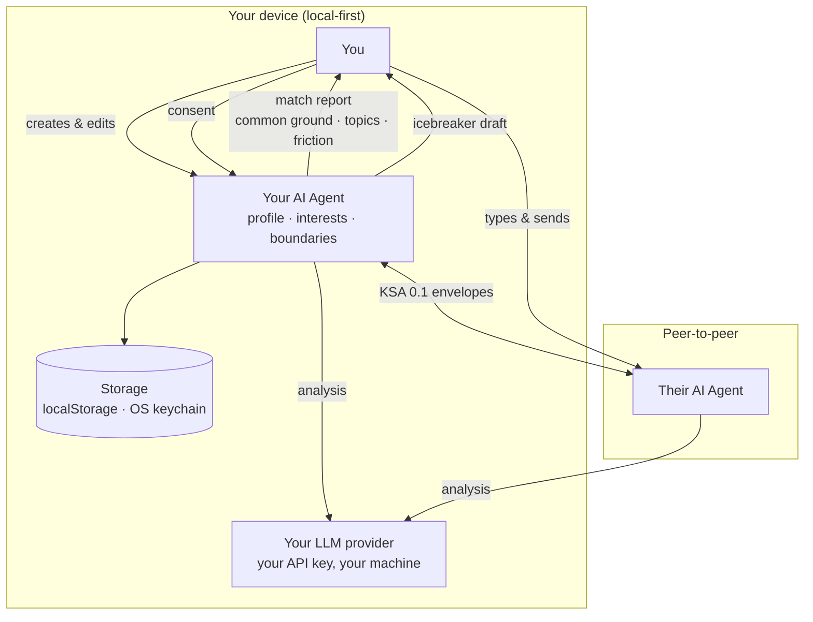

# Kindora

### Your AI finds the connection. You make the friendship.

An open-source, local-first AI social agent client exploring a new way for people
to connect through personal AI agents.

**Your AI discovers common ground. You decide who to connect with.**

[](https://github.com/free-revalution/Kindora/actions/workflows/ci.yml)
[](LICENSE)
[](https://github.com/free-revalution/Kindora/stargazers)
[](https://github.com/free-revalution/Kindora/issues)
[](https://github.com/free-revalution/Kindora/discussions)


---

## What is Kindora?

Kindora is an open-source experiment exploring AI-assisted social discovery.

Instead of relying entirely on a traditional recommendation algorithm, Kindora
gives each person a personal AI agent. That agent understands the user's
interests, social intent and conversation style, and helps discover meaningful
connections with other people's agents.

The user stays in control of their profile, their privacy boundaries, and every
connection decision. Kindora never sends a message on your behalf.

**Kindora is not a dating app, and not a feed.** There is no ranking algorithm
deciding what you should see. Two agents meet, find common ground, and report
back — a human decides what happens next.

---

## How it works



Legend — **solid lines are implemented and covered by automated tests**; the
dashed edge below is **planned, not implemented**:

- ✅ Implemented: profile storage, KSA 0.1 envelopes (validated, replay-guarded,
  rate-limited), LAN transport (real UDP + TCP), agent-to-agent matching,
  consent, icebreaker, chat.
- ⛔ Not implemented: cross-network (WebRTC) pairing — `WebRtcTransport` is a
  stub and `connect()` throws. **Same-LAN only.**

Full capability-by-capability status, with the evidence for each claim:
[docs/DEVELOPMENT_STATUS.md](docs/DEVELOPMENT_STATUS.md).

---

## Status: read this before you assume anything works

**V0.1 — Experimental. Source only: no releases, no installers.**

> The desktop app builds and launches, but **no complete two-machine session has
> been driven through the GUI by hand yet**, and **no automated test has ever
> called a live LLM provider** — every LLM test mocks `fetch`. Real API
> schemas, auth headers and error shapes remain unverified.
>
> What *is* verified: the TypeScript workspace and the Rust transport layer,
> by automated tests. The LAN integration suite binds **real UDP and TCP
> sockets**; it does not exercise the React UI against a real Tauri window.

Please read the [Features](#features) section before opening an issue that
assumes a feature works.

---

## Features

### ✅ Implemented and covered by automated tests

| Feature | Where |
|---|---|
| Personal AI social agent — create, edit, persist | `packages/agent`, `packages/storage` |
| Bring-your-own LLM — OpenAI-compatible, Anthropic, Ollama, MiniMax | `packages/llm`, `apps/desktop/src/lib/llm-service.ts` |
| API keys in the OS-native secret store (macOS Keychain / Windows Credential Manager / Linux Secret Service) | `apps/desktop/src-tauri/src/secrets.rs` (`keyring`) |
| KSA 0.1 wire protocol — schema validation, replay guard, rate limiter, sensitive-field guard | `packages/protocol` |
| LAN transport — UDP broadcast discovery on port **52419**, then a TCP channel | `packages/transport`, `apps/desktop/src-tauri/src/lan.rs` |
| Loopback transport for in-process development and tests | `packages/transport` |
| Agent-to-agent matching — 5-field report (compatibility signal, common ground, recommended topics, potential friction, explanation) | `packages/agent`, `packages/matching` |
| Human consent flow — accept / reject / disconnect / block, with a persisted block list | `packages/matching`, `packages/storage` |
| Icebreaker generation — propose, use, edit, regenerate, skip | `packages/agent`, `packages/matching` |
| Human-to-human chat, plus an "Ask My Agent" panel that only fills your draft | `packages/matching`, `apps/desktop/src/views/ChatView.tsx` |
| Prompt-injection sanitiser with credential-pattern stripping | `packages/protocol` |
| English + 简体中文 UI, switchable in Settings | `apps/desktop/src/i18n` |
| Human in the loop throughout — **the AI never auto-sends** | `packages/matching` |

### 🧪 Implemented, but not yet validated end-to-end

- **The desktop app in a real window.** It builds and runs. A full two-machine
  session has not been completed by hand.
- **Every LLM-dependent feature.** All tests mock `fetch`. No test has called a
  live provider.
- **LAN pairing through the GUI.** Verified at the Rust socket layer and via a
  JS IPC shim — not through React against a real Tauri window.

### ❌ Not implemented

- **WebRTC / cross-network pairing** — `WebRtcTransport` is a stub; `connect()`
  throws. **Same-LAN only.**
- **SQLite persistence** — the `tauri-plugin-sql` plugin is registered, but **no
  TypeScript code calls it**. All state lives in `localStorage`.
- **Chat history persistence** — messages are lost on window close.
- **Private-key encryption at rest** — the agent's PKCS8 private key is stored
  base64-encoded (i.e. plaintext) in the webview's `localStorage`.
- **QR-code pairing** — the payload helpers exist in
  `packages/transport/src/qr-payload.ts`; there is no UI.
- **Block-list management screen** — blocking works and persists, but there is
  no screen to view or edit the list.
- **Releases / installers** — none. Build from source.

---

## Technology stack

| Layer | Choice |
|---|---|
| Desktop shell | [Tauri 2](https://tauri.app/) |
| UI | React 18 + TypeScript 5 + Tailwind CSS |
| Core / transport | Rust (`tokio`) — `apps/desktop/src-tauri` |
| Language runtime | Node.js ≥ 20, pnpm 10 workspaces |
| LLM integration | OpenAI-compatible, Anthropic, Ollama, MiniMax adapters |
| Transport | UDP discovery + TCP (LAN), in-process loopback, WebRTC stub |
| Storage | `localStorage` (profiles, settings, block list) + OS keychain (secrets) |
| Tests | Vitest + React Testing Library (TS), `#[tokio::test]` (Rust) |

There is no server component. Kindora has no backend, no account system, and no
telemetry — the only network traffic is to your own LLM provider and to the
other device on your LAN.

---

## Getting started

### Prerequisites

| Tool | Version | Notes |
| --- | --- | --- |
| Node.js | ≥ 20 | from `package.json` `engines` |
| pnpm | 10 | `packageManager: pnpm@10.32.1` |
| Rust | **stable** | pinned by `rust-toolchain.toml` in the repo root |

Linux additionally needs `libwebkit2gtk-4.1-dev`, `libgtk-3-dev`,
`librsvg2-dev`, `patchelf`, `build-essential`, `libssl-dev`. On macOS install
the Xcode Command Line Tools; on Windows you need WebView2 and MSVC.

### Install

```bash
git clone https://github.com/free-revalution/Kindora.git
cd Kindora

# Install Rust (one-time, if you do not have it)
curl --proto '=https' --tlsv1.2 -sSf https://sh.rustup.rs | sh

pnpm install
```

`rust-toolchain.toml` pins the Rust toolchain to `stable`, so `cargo` picks the
right version automatically inside this directory — no manual `PATH` juggling.

### Run the desktop app

```bash
pnpm -C apps/desktop tauri:dev
```

> **`pnpm dev` at the repository root starts only a Vite dev server** on
> `127.0.0.1:1420` — it does **not** launch the desktop app. Use
> `pnpm -C apps/desktop tauri:dev`.
>
> Running `pnpm -C apps/desktop tauri:dev` from *inside* `apps/desktop` will
> fail with `ENOENT ... /apps/desktop/apps/desktop` — the `-C` path is
> resolved relative to the repository root.

### Test

```bash
# TypeScript — Vitest workspace
pnpm test
pnpm typecheck
pnpm lint

# Rust — run from the Tauri crate
cd apps/desktop/src-tauri
cargo test --lib                                          # unit tests
cargo test --test lan_e2e -- --test-threads=1             # LAN over real sockets
cargo test --test lan_protocol_e2e -- --test-threads=1   # KSA protocol E2E
```

The Rust integration suites bind **real UDP and TCP sockets**. `--test-threads=1`
is required: parallel execution is unreliable against the macOS and Linux
kernel UDP buffer pools.

### Troubleshooting

| Symptom | Cause | Fix |
| --- | --- | --- |
| `error: feature 'edition2024' is required` | Default Rust toolchain is too old (1.77.2) | `rustup default stable`, or rely on the repo's `rust-toolchain.toml` |
| `cargo run could not determine which binary to run` | No `default-run` in `Cargo.toml` | `cargo run --bin kindora-desktop` |
| `failed to run custom build command for 'openssl-sys'` (Linux) | Missing OpenSSL headers | `sudo apt install libssl-dev` |
| `webkit2gtk` not found (Linux) | Missing system packages | Install the Linux prerequisites above |
| A web page at `localhost:1420` instead of a window | `pnpm dev` was used | Use `pnpm -C apps/desktop tauri:dev` |
| `ENOENT ... /apps/desktop/apps` | `pnpm -C apps/desktop …` was run from inside `apps/desktop` | Run it from the repository root |
| `error: Address already in use (os error 48)` on UDP 52419 | A previous Kindora instance is still holding the discovery port | Quit the other instance; the port is fixed by design |

---

## Repository layout

```text
Kindora/
├── apps/
│   └── desktop/
│       ├── src/                  React UI (10 screens) + Tauri services + i18n
│       └── src-tauri/            Rust: LAN transport + OS keychain
│           ├── src/lan.rs        UDP 52419 discovery, TCP link, lan_* commands
│           ├── src/secrets.rs    keyring → OS keychain, secret_* commands
│           └── tests/            lan_e2e + lan_protocol_e2e
├── packages/
│   ├── protocol/         KSA 0.1 envelope, validation, replay guard, rate limiter
│   ├── agent/            Ed25519 identity, match analysis, icebreaker generation
│   ├── llm/              Provider adapters (openai-compatible, anthropic, ollama, minimax)
│   ├── matching/         match / consent / icebreaker / chat orchestrators
│   ├── storage/          profile, settings, secrets, block list (localStorage)
│   └── transport/        LAN (real) · Loopback · WebRTC (stub) · PairingSession FSM
├── docs/                 PRODUCT · ARCHITECTURE · PROTOCOL · COMMUNITY · DEVELOPMENT_STATUS
├── experiments/          Phase 2.1 cross-process UDP harness (standalone crate)
└── ROADMAP.md            What is planned, and what is deliberately out of scope
```

---

## Roadmap

See [ROADMAP.md](ROADMAP.md). Every item there that is not checked off is
genuinely not done — the file is a direction, not a promise.

---

## Contributing

Kindora is a small project maintained in someone's spare time. A well-explained
bug report is as valuable as a patch, and there is a documented list of tasks
that are deliberately left open for newcomers.

- [CONTRIBUTING.md](CONTRIBUTING.md) — setup, PR guidance, how to add a language
- [CODE_OF_CONDUCT.md](CODE_OF_CONDUCT.md) — Contributor Covenant 2.1
- [SECURITY.md](SECURITY.md) — threat model and private vulnerability reporting
- [docs/COMMUNITY.md](docs/COMMUNITY.md) — discussions, issues, and how we work

Start with the **good first issue** label, or open a [technical
proposal](.github/ISSUE_TEMPLATE/technical_proposal.yml) if you want to change
something structural.

---

## Community

- [GitHub Discussions](https://github.com/free-revalution/Kindora/discussions) — ideas, questions, development notes
- [GitHub Issues](https://github.com/free-revalution/Kindora/issues) — bugs and tasks
- [docs/COMMUNITY.md](docs/COMMUNITY.md) — how to take part
- [docs/DEVELOPMENT_STATUS.md](docs/DEVELOPMENT_STATUS.md) — what is really done

---

## License

[MIT](LICENSE) © 2026 Kindora Contributors
